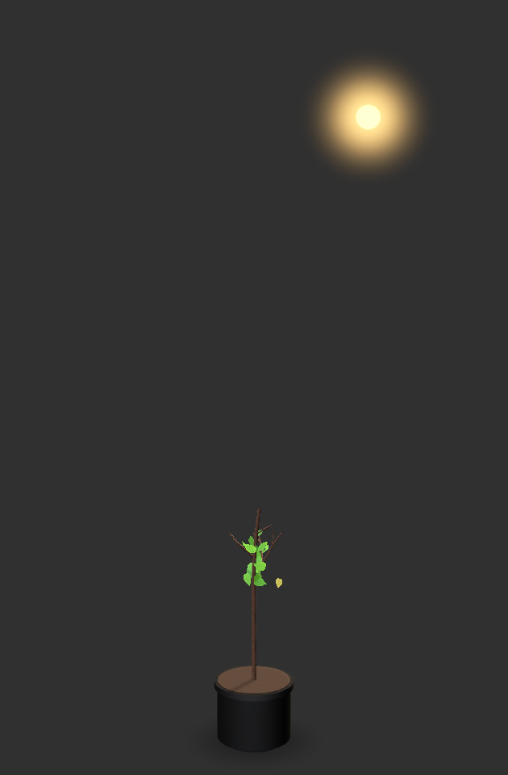
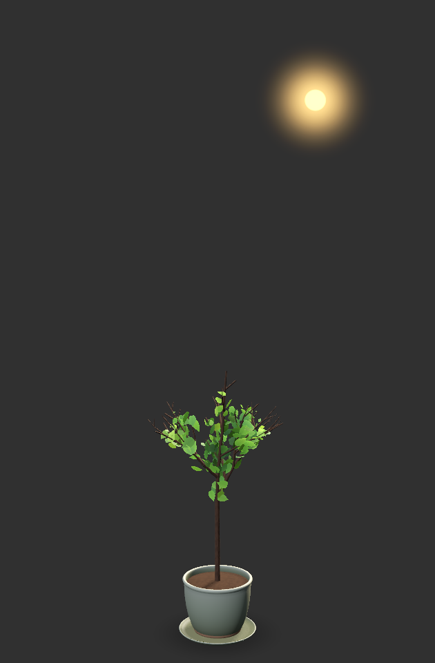
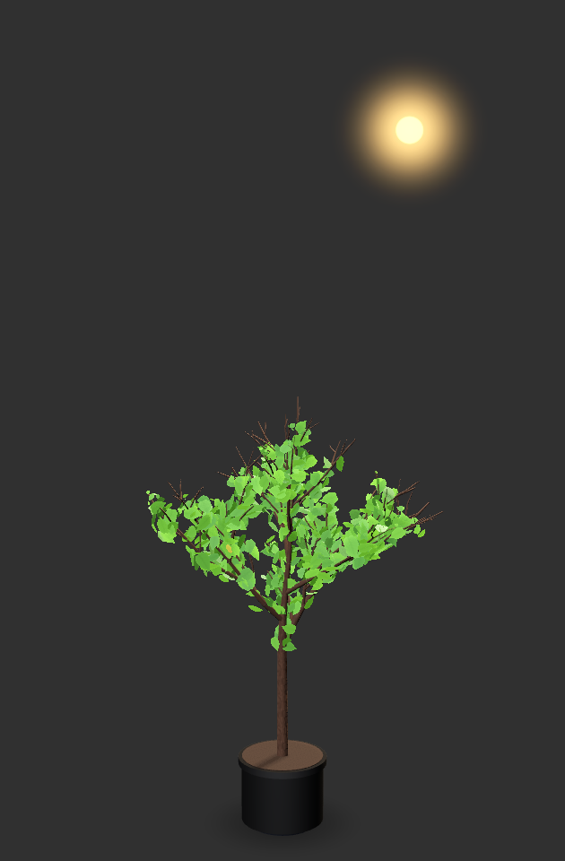
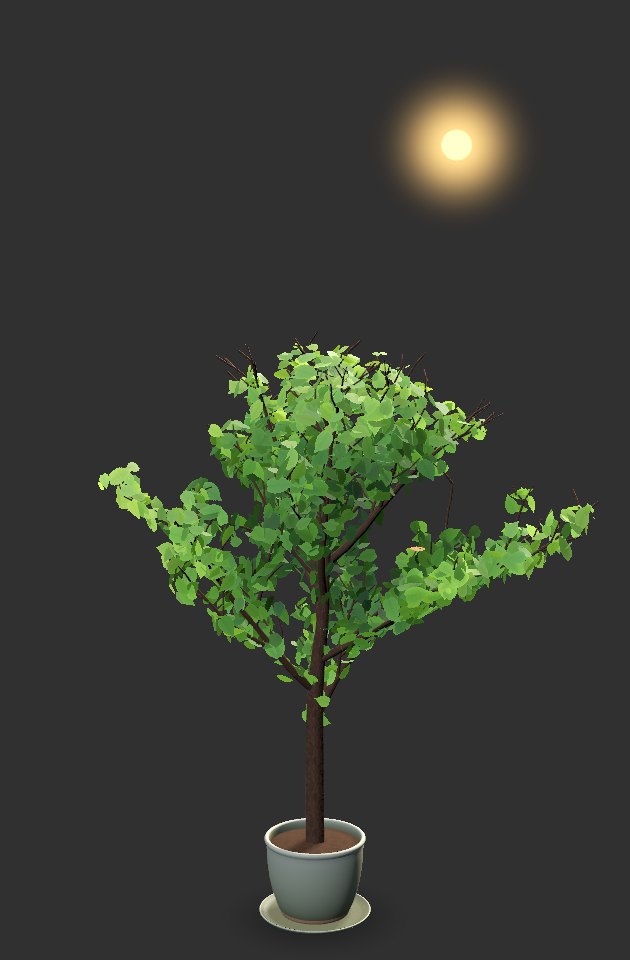
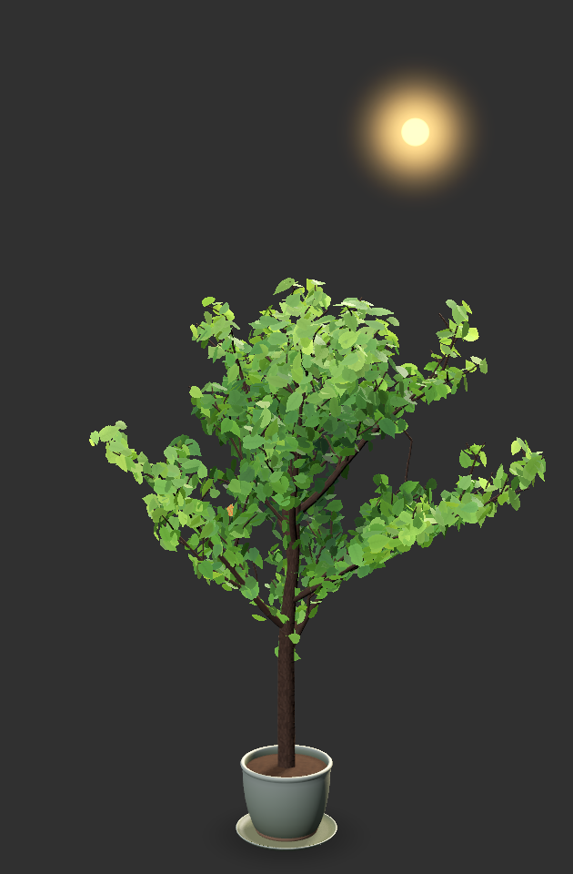
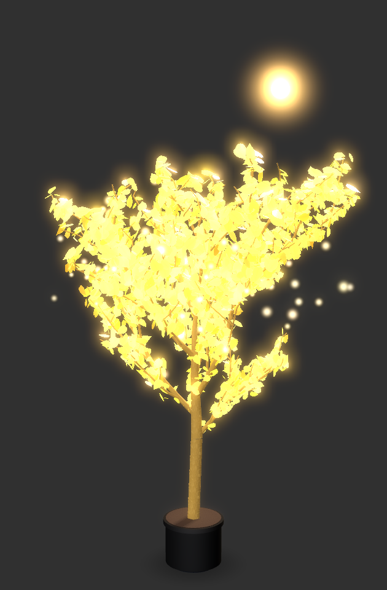
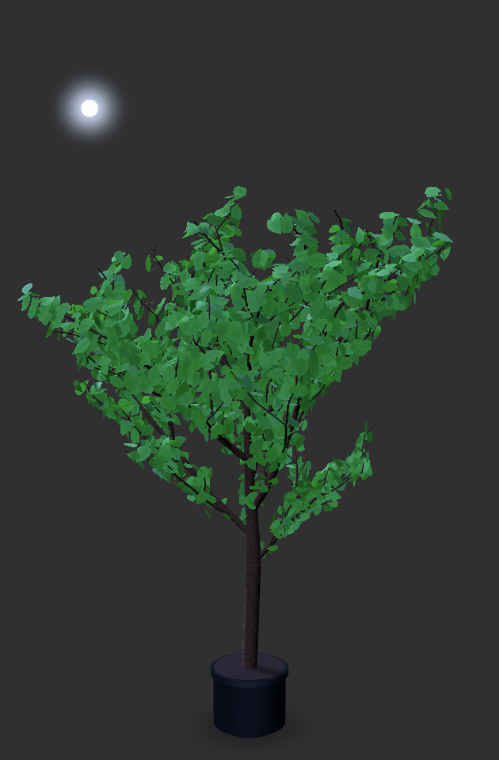
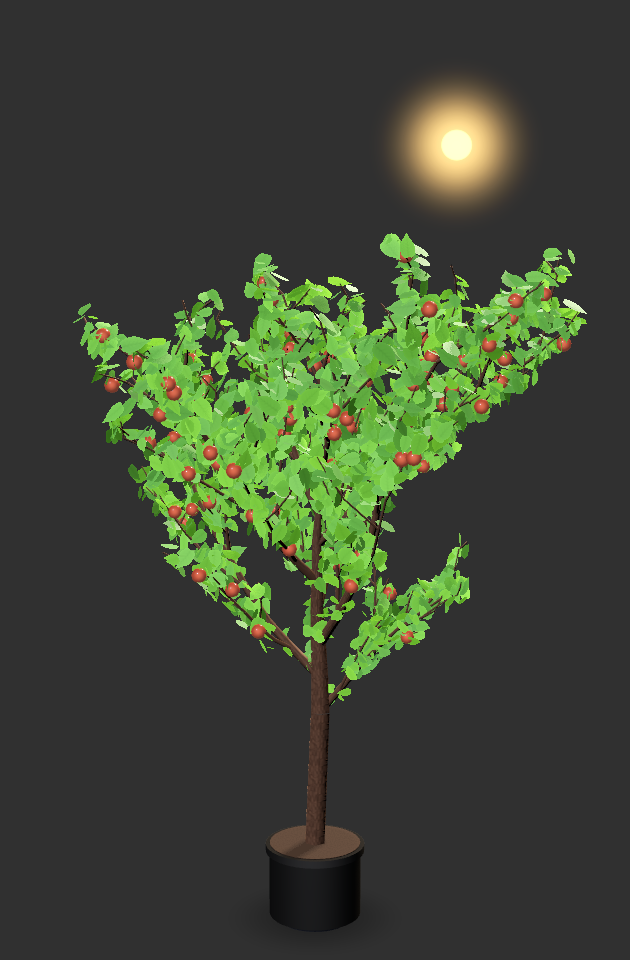
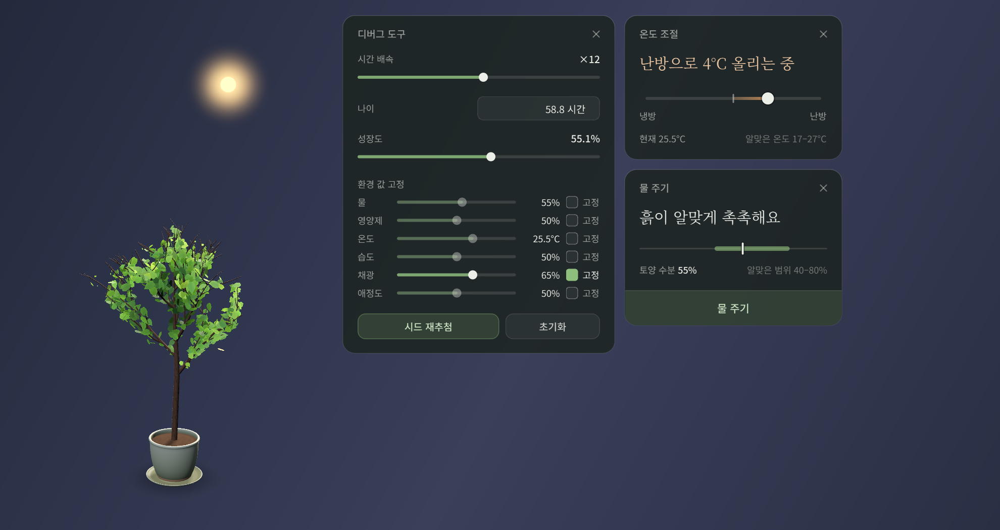
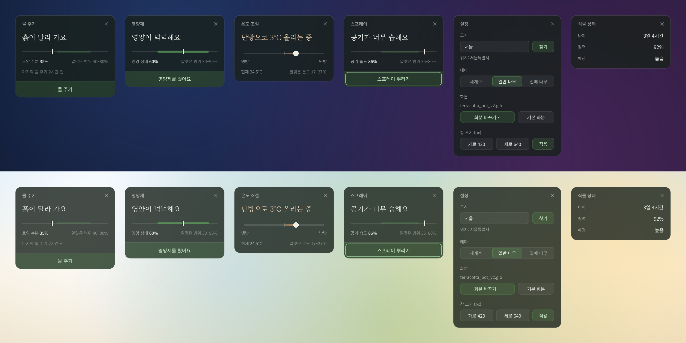

# Fernal

Fernal is a desktop companion for Windows: a procedurally generated 3D plant that grows in a transparent, always-on-top window on your desktop. Water, nutrients, temperature, humidity, light and affection shape every branch, so the plant grows lopsided and reacts to how you treat it. The sun and moon cross the top of the window with the real time of day, light and temperature follow your local weather, and time you spend away is replayed when you come back. There are three looks (a glowing world tree, an ordinary tree and a fruit tree) and you can swap the pot for your own `.glb` model. Everything in the window is 3D (Qt Quick 3D); the tools, menus and settings are Qt Widgets. The interface text is Korean.

<p align="center">
  
  
  
  
  
</p>
<p align="center"><em>The same plant at 20, 35, 50, 75 and 100 percent of its growth.</em></p>

<p align="center">
  
  
  
</p>
<p align="center"><em>Erdtree by day, normal tree by night, fruit tree by day.</em></p>

<p align="center">
  
</p>
<p align="center"><em>The overlay with three panels open beside it (debug tool, climate, watering).</em></p>

<p align="center">
  
</p>
<p align="center"><em>Care panels, settings and the glass look on a dark and a light wallpaper. The sixth card ("식물 상태") is a styling sample from <code>scripts/preview_panels.py</code>, not a panel of the app.</em></p>

## Requirements

- Windows 11 (the overlay uses Win32 window flags; only Direct3D 11 has been tried)
- Python 3.14 (developed on 3.14.7)
- The three packages in `requirements.txt`: `PySide6>=6.11`, `numpy`, and `pytest` (only needed for the tests)
- Internet access is optional. Without it the plant runs on a synthesized sun and the last known weather.

## Install

```bat
python -m venv .venv
.venv\Scripts\activate
pip install -r requirements.txt
```

In PowerShell the activation script is `.venv\Scripts\Activate.ps1`.

## Run

From the repository root:

```bat
python -m fernal
```

For no console window, use the windowless interpreter of the virtual environment (warnings and errors are then invisible):

```bat
.venv\Scripts\pythonw -m fernal
```

The window appears at its saved position (first run: near the top-left of the primary screen, 420 x 640) and a tray icon is added. Quit from the right-click menu or the tray menu; the state is saved on quit.

## Controls

| Action | Result |
|---|---|
| Left-drag | Move the window |
| Shift + left-drag | Orbit the camera around the plant |
| Mouse wheel | Zoom in and out |
| Hover or click the plant | Raises affection a little (+0.05 each) |
| Right-click | Context menu: water, nutrients, climate, spray, settings, theme, change pot, click-through, quit |
| Tray icon | Left-click pops up the same menu at the cursor; right-click shows it in the usual place |
| Esc (in a panel) | Close the panel. Panels can be dragged by their title. |

**Click-through.** The menu entry "클릭 통과" lets every mouse click pass through the plant to the windows behind it. While it is on, the plant cannot be clicked, so the tray icon is the only control: left-click the tray icon and untick "클릭 통과" (or choose "종료" to quit). Click-through always starts off, and the entry is disabled if the system has no tray.

**Care tools.** Each menu entry opens a small panel beside the window. A panel shows one sentence about the plant, a gauge with the healthy range, and an action.

| Tool | Effect |
|---|---|
| 물 주기 (water) | Soil moisture +0.2 |
| 영양제 (nutrients) | Nutrients +0.3 |
| 온도 조절 (climate) | Slider from -10 to +10 degC added to the outdoor temperature (cooling to heating) |
| 스프레이 (spray) | Air humidity +0.15 |
| 설정 (settings) | City, theme, pot file, window size |

**Settings.**

- City: type a name and press 찾기 or Enter (see "Weather and location").
- Theme: choose one of three. The same choice is in the menu.
- Pot: pick a `.glb` or `.gltf` file, or "기본 화분" for the built-in celadon pot. The menu entry "화분 바꾸기…" opens the file dialog directly. A missing or unreadable file falls back to the default pot.
- Window size: width 240 to 900 px, height 360 to 1400 px, applied with 적용.

## Themes

| Theme | Look |
|---|---|
| 세계수 (erdtree) | Dark-gold bark with glowing cracks, amber leaves with luminous tips, bloom, drifting golden motes |
| 일반 나무 (normal) | Layered greens that turn gold and rust when the plant is unwell, an occasional falling leaf |
| 열매 나무 (fruit) | The normal tree plus persimmon fruit; the more affection, the more fruit |

## How growth works

Six values describe the plant's surroundings: water, nutrients, temperature, humidity, light and affection. They drift with time (water evaporates faster in heat and light, nutrients and affection fade by 0.1 per day) and with your care. Each one steers the shape of the tree: nutrients set how much it branches, water sets branch length and leaf size (a dry plant droops), humidity sets leaf density, light sets how strongly the branches lean toward the sun, and affection sets the fruit count. Every branch has its own random jitter derived from the seed and the branch number, so moving a value reshapes the same tree instead of rolling a new one. A vitality score (how far each value is from its comfort band) scales the growth speed and turns the leaves toward autumn colors.

The first run starts as a young leafy tree (48 plant hours; a full-grown plant is about 104) with a time scale of 8, so plant time runs eight times faster than the clock and the tree fills out within about a day. Plant age advances while the program runs. When you start it again, the time since the last save is replayed in 10-minute steps, up to 7 days: the sun is computed for each step, temperature and humidity come from the last stored weather. The state (plant, theme, pot, position, city) is saved every minute and on quit to `%APPDATA%\Fernal\state.json`. A corrupt file is moved to `state.json.bak` and a fresh plant starts; a saved position that is off every screen is recentered.

## Weather and location

Temperature, humidity and sunshine come from [Open-Meteo](https://open-meteo.com) (no API key): the current conditions are fetched once at startup, then every hour and once after a successful city change, with a 5 second timeout. If a fetch fails, the last values stay; before the first successful fetch the sunshine is synthesized from the sun's height. The city defaults to Seoul. Typing a city name in the settings looks it up with the Open-Meteo geocoding service, and only when you press 찾기 or Enter. The sun and moon positions are computed locally from latitude, longitude and the local time.

## Debug tool

A hidden panel for tuning and testing, opened with Ctrl+Shift+D (click the plant or any panel first so the window has keyboard focus) or with Ctrl+Shift+right-click on the plant. It can set:

- time scale, 0.1 to 1000 (log slider)
- plant age in hours
- growth percent, 0 to 100 of full size
- a new random seed (the plant regrows differently)
- any of the six environment values, pinned with a checkbox (temperature -10 to 45 degC)
- reset: a fresh plant at the first-run age and speed; place, theme, pot and last weather are kept

The time scale and pinned values are saved with the state, so set them back when you are done.

## Screenshot CLI

Renders one frame of the plant and exits (the window is shown briefly while it renders):

```bat
python -m fernal --screenshot out.png --theme erdtree --age 300 --seed 7 --hour 14
```

| Option | Meaning |
|---|---|
| `--screenshot PATH` | Write a PNG of the window (420 x 640 logical pixels times the display scale) and exit with code 0 |
| `--theme {erdtree,normal,fruit}` | Theme (default: normal) |
| `--age HOURS` | Plant age in hours (screenshot default: fully grown) |
| `--seed N` | Plant seed (screenshot default: 1) |
| `--hour H` | Local hour for the sun, for example `6.5` or `22` (default: now) |
| `--state PATH` | Alternative state file for normal runs, handy for a test plant: `python -m fernal --state test.json --theme fruit --seed 4`. Screenshot mode never reads or writes a state file. |

Exit codes: 0 written, 2 the QML scene failed to load, 3 the PNG could not be written, 4 no frame was rendered within 30 seconds.

## Tests

```bat
python -m pytest -q
```

About a hundred tests run in under ten seconds: simulation, skeleton, mesh, sky and weather parsing, the tool panels, the overlay window and the controller. They create hidden Qt windows (so run them in a desktop session) and need no network.

## Project layout

```
fernal/
  __main__.py       command line entry and argument parsing
  app.py            controller: state, timers, windows, weather and city workers, screenshot mode
  overlay.py        transparent window, QML bridge, context menu, tray icon
  tools.py          glass panel base, care tool panels, settings panel
  debug_panel.py    hidden debug panel
  sim.py            environment simulation, vitality, catch-up, state file
  tree.py           seeded branching skeleton
  mesh.py           numpy mesh builders and the QQuick3DGeometry bridge
  sky.py            sun position, Open-Meteo weather and geocoding
  themes.py         theme table
  qml/Scene.qml     the only QML file: the 3D scene
  qml/shaders/      wind, bark, leaf, fruit, contact and celestial shaders
  assets/           bark, bark normal and leaf textures, tray icon
scripts/
  make_textures.py  regenerates fernal/assets/*.png
  preview_*.py, spike_overlay.py, spike.qml   throwaway harnesses from development
tests/              pytest suite
docs/               design spec, plan, design plan, review and QA notes, screenshots
```

## Known limitations

- **Render loop.** Fernal forces Qt's basic render loop (`QSG_RENDER_LOOP=basic`) because the Python `event()` override of the window hangs Qt's default threaded loop on the first frame. Rendering therefore shares the GUI thread. On the development machine the idle cost is about 10 percent of one CPU core and about 9 percent GPU at 60 fps.
- **Fonts.** No font is bundled. The panels use Noto Sans KR and Noto Serif KR when installed, otherwise Malgun Gothic or Segoe UI. Pretendard, mentioned in the early spec, is not used.
- **Windows only.** Only Windows 11 with Direct3D 11 has been tried.
- **Korean interface.** All labels and messages are Korean.
- **One plant, one instance.** Starting the program twice opens two windows that overwrite each other's state file.
- **Weather detail.** Only the current conditions are used, no history or forecast, and a failed fetch is not retried before the next hour.

More in `docs/superpowers/notes/review.md` (open issues) and `docs/superpowers/notes/manual-qa.md` (checks that need a real screen).
